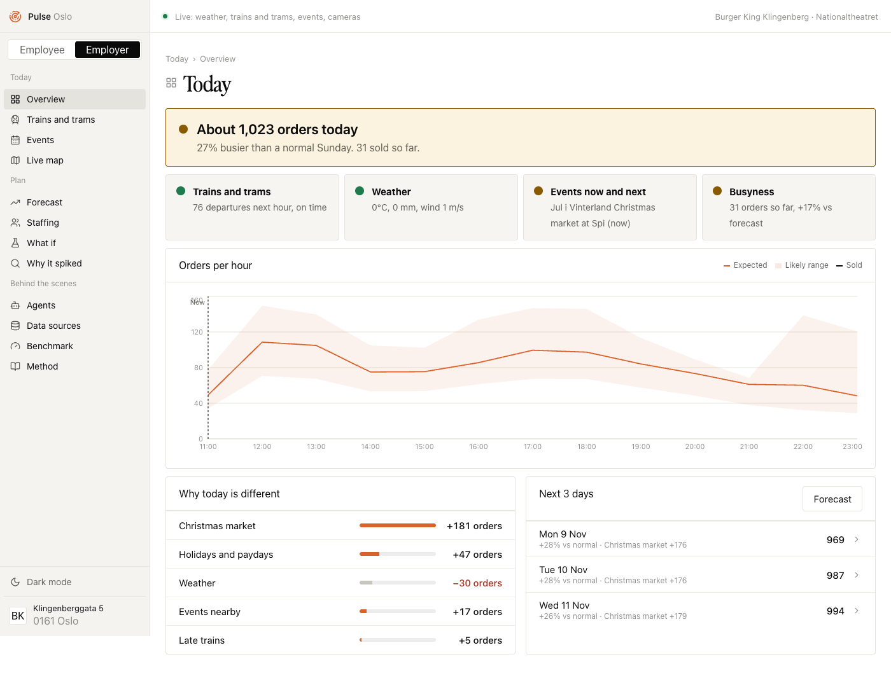
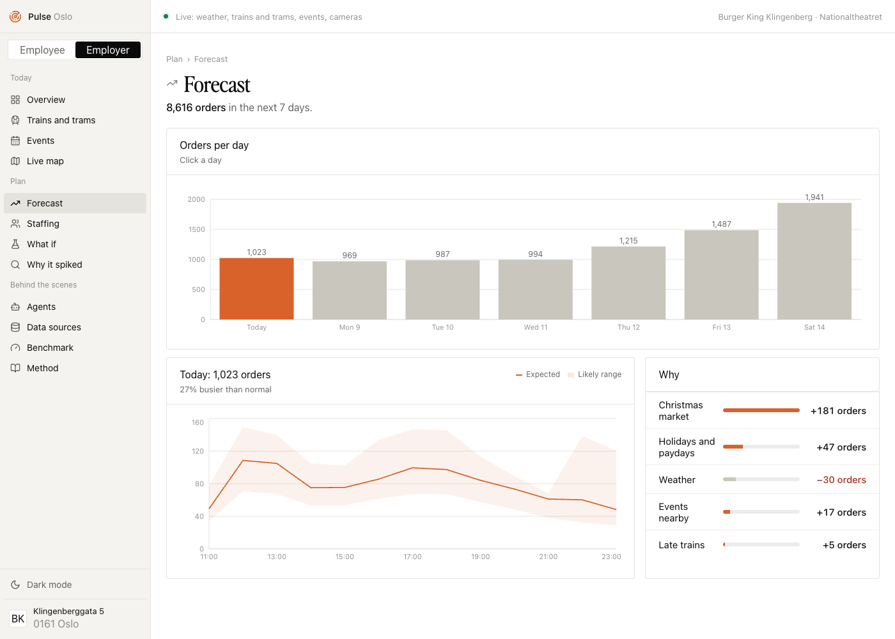
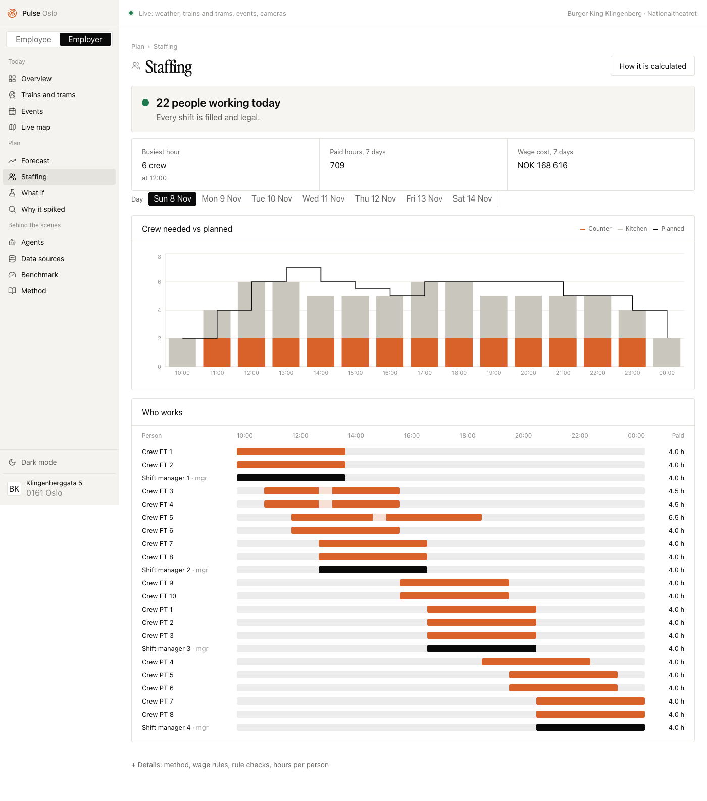
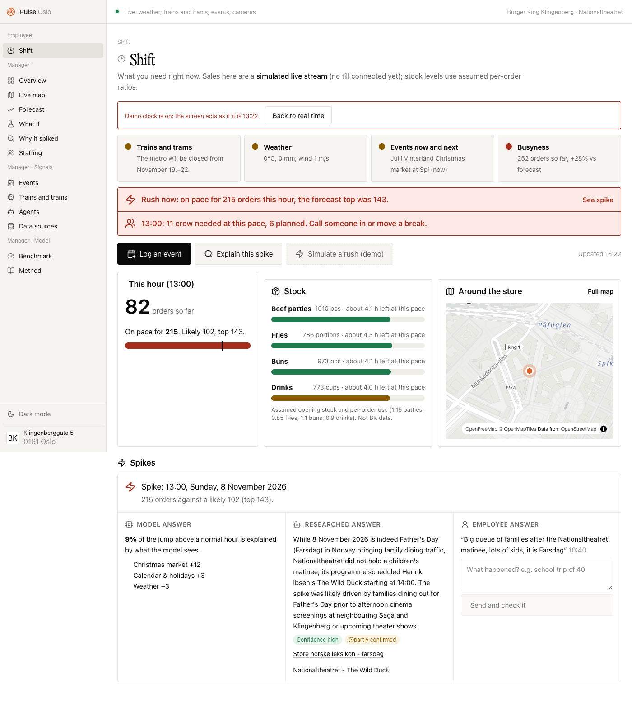
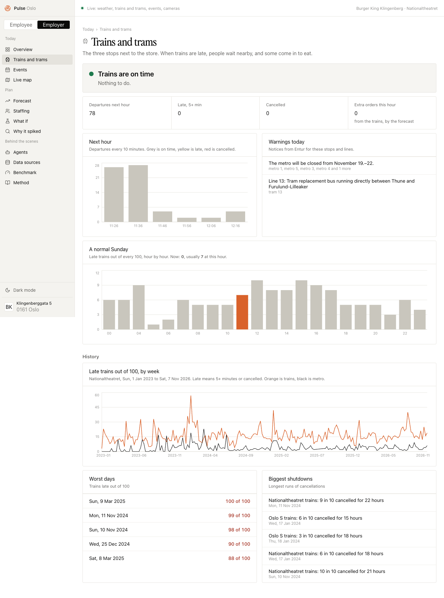

# Pulse

**Know the rush before it hits.**

Pulse watches the area around one fast food store and tells the manager, hour by hour, how busy the store will be, how many people the shift needs, and why. It reads local events, trains and disruptions, weather, holidays and more, in real time.

Built in 48 hours at Oslo Sprint 2026 on a real store: **Burger King Klingenberggata 5**, by Nationaltheatret in Oslo. Nothing in the method is tied to Oslo. Any store with an address can get the same local picture.



## Why

- A Burger King owner near Aker Brygge told us his hardest problem is planning around what happens near the store: trains that stop, events, weather, and knowing why a good day was good.
- At Domino's I lived the other side. There was no forecast, so when a rush hit, staff were called in at short notice for a few hours.
- Fast food margins are thin and staff is the biggest cost a store controls. Being wrong in either direction costs money or a stressed crew.

## What it does

1. **Forecast:** orders for every hour of the next 7 days, with a likely range (P10 to P90) and the reasons behind each hour.
2. **Staffing:** turns the forecast into crew per hour (Erlang C) and a legal shift plan under the Norwegian Working Environment Act.
3. **Live shift view:** compares sales so far with the forecast and raises an alarm early when a rush is building, so the manager can call help in time.
4. **Why it spiked:** finds days above the likely range and ranks the causes. An AI agent researches each spike, and crew notes are added to the record.
5. **What if:** switch on a train closure, heavy snow, a cruise day or an event and the real model reruns.
6. **Live map:** the store, live trains and buses, nearby places, events and road cameras.

| Forecast | Staffing |
|---|---|
|  |  |
| **Live shift (rush demo)** | **Trains and trams** |
|  |  |

## Demo film and pitch

- `video/` is the demo film, built with [HyperFrames](https://hyperframes.heygen.com) (HTML rendered to video). Run `npx hyperframes preview` inside `video/` to open it.
- `docs/pitch/` holds the pitch deck.

## Stack

- Next.js 15, React 19, Tailwind 4, Recharts, MapLibre.
- LightGBM quantile models trained in Python, exported and run in TypeScript (parity tested).
- Gemini on Vertex AI for the agents (event scout, camera watcher, staffing overseer, spike research).
- Data: MET Norway (Locationforecast and Frost), Entur (Journey Planner, vehicles, SIRI-ET history on BigQuery), context.dev for venue programmes, Statens vegvesen road cameras, Norwegian holidays.

## Run it

```bash
npm install
npm run dev
```

Open http://localhost:3000. `.env.local` (git-ignored, server-side only) holds:

- `CONTEXT_DEV_API_KEY`: event scraping.
- `FROST_CLIENT_ID`: official MET Norway weather.
- `GCP_PROJECT_ID`, `GCP_LOCATION`, `GEMINI_MODEL`: the Gemini agents (Vertex AI). Auth is gcloud Application Default Credentials (`gcloud auth application-default login`), so there is no key file.

Without them the app still runs on the cached data.

## Pages

| Page | What it shows |
|---|---|
| Overview | Today's orders, staff needed now, live weather, trains, events, and what moves sales today |
| Live map | Store, 500 m to 2 km rings, live trains and buses, nearby places, events, live cameras |
| Forecast | Next 7 days by hour, with P10, P50 and P90 and the reasons per hour |
| Why it spiked | Days above the likely range, with ranked causes |
| What if | Add an event or switch on T-bane closed, heavy snow, cruise day, payday or Christmas market; the real model reruns and shows orders, staff, wage cost, busiest hour, what to change and why |
| Staffing | Erlang C staff per hour, a set-covering shift plan, a legal roster for 45 people, and a worked example |
| Events | Event library, every event with a source link |
| Trains and trams | Real Entur delay history and the biggest disruptions |
| Agents | Three Gemini agents with a Run now button: event scout, camera watcher, staffing overseer |
| Benchmark | Error against baselines, range hit rate, effect recovery, ablation, spike finder |
| Method, Data sources | Full method and sources (from `docs/`) |

## What is real and what is simulated

- **Real, live:**
  - Weather: met.no Locationforecast, plus the latest official observation from MET Frost (Oslo Blindern).
  - Departures, delays and disruption notices: Entur Journey Planner.
  - Train and bus positions: Entur vehicle API.
  - Venue programmes: scraped with context.dev.
- **Real, historic:**
  - Weather 2023 to now: MET Frost SN18700, with 0.6% gap-filled from Open-Meteo.
  - Norwegian holidays and school breaks.
  - About 1.8 million real stop calls at Nationaltheatret (Entur SIRI-ET on BigQuery), with disruption episodes.
  - A sourced event library: 17 May, Nobel, Jul i Vinterland, concerts, protests, IShowSpeed, outages.
- **Simulated:**
  - Hourly sales, built on the real inputs, with logged ground truth so effect recovery can be scored.
  - Cruise calls: a pattern from CruiseMapper July 2027 (151 calls; 8 ships on 3 and 4 Jul), with an assumed May to September shape.
  - Store shape: channel mix (counter, kiosk, Wolt), items per order, basket value, 15-minute slots and day-to-day noise, checked against the columns real POS datasets carry.
  - The roster mix.
  - Some staffing parameters, each labelled as an assumption.

Synthetic sales prove the pipeline and the method, not real effect sizes. With real POS data, only the sales source changes.

## Model and results (test year 2025-11-01 to 2026-11-07, held out)

- **Model:**
  - LightGBM quantile models (P10, P50, P90), calibrated with split conformal prediction.
  - Inference runs in TypeScript from the exported trees; a parity test against Python passes.
- **Error (WAPE):** 21.4%, against 31.0% (hour × weekday mean) and 32.2% (same hour last week). The noise floor is 19.1%; it rose when day-to-day noise was added to the simulator.
- **Range:** P10 to P90 catches 78.5% of hours, against an 80% target.
- **Spike finder:** the true cause ranks first on 85% of 40 spike days and in the top 3 on 100%.
- **Effect recovery (transit):** the model estimates 18.55 extra orders per hour against 17.85 true, with a correlation of 0.906.
- **Events, still the weak spot:** 87 real event hours in the test year. Error on those hours is 22.2% against 28.0% for the hour × weekday mean, but the effect size is under-estimated (3.12 vs 9.79). Crowds via Nationaltheatret (Ullevaal, Holmenkollen, Unity Arena, Bislett, Ekeberg, with assumed route shares) get the timing right (correlation 0.99). The Benchmark page shows this under Weak spots.

## Agents

All three run on Vertex AI (global endpoint) with the model in `GEMINI_MODEL`. Each run makes one model call, has a timeout, and refuses a second run while one is going. Results are saved with a timestamp in `agent-runs/` (git-ignored) and shown on the Agents page.

- **Event scout:** Gemini with Google Search grounding finds events near the store in the next 14 days. Events without a source URL are dropped; the rest are deduped against the library and marked "agent-found, unreviewed". They do not feed the model until reviewed.
- **Camera watcher:** Gemini vision reads the 6 Statens vegvesen road camera stills and returns JSON (traffic, road surface, rain or snow, visibility, incidents). These are road cameras 1.6 to 9.8 km away, not the store's street.
- **Staffing overseer:** compares the next 6 hours of forecast, weather, transit notices and agent-found events with the planned crew, and flags under- or over-staffing with a reason and a suggested change. Advisory only; it never edits the roster.
- Not built: the optional 5-minute schedule. Agents run on Run now only.

## Checks

```bash
npx tsx scripts/model/parity.ts
```

```bash
npx tsx scripts/staffing/test.ts
```

- **parity.ts:** TS features and predictions must equal Python's, and they do.
- **test.ts:** 38 checks. They cover Erlang C against published values, coverage, and Working Environment Act rules (§ 10-4, 10-8, 10-9, 10-11, 11-2, 11-3, 11-5).

Retrain:

```bash
model/.venv/bin/python model/train.py && model/.venv/bin/python model/write_docs.py && npx tsx scripts/model/parity.ts
```

## Notes

- The Perfectly Nineties display font is not in this repository because of its licence. Without it, titles fall back to a system serif. Add your own copy at `public/fonts/perfectlynineties.otf` if you hold a licence.
- No keys are in this repository. Secrets live only in `.env.local`, which is git-ignored.
